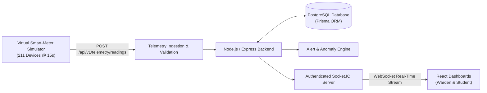

# ⚡ WattWise — Real-Time IoT Hostel Energy Intelligence Platform

[](https://nodejs.org/)
[](https://www.postgresql.org/)
[](https://www.prisma.io/)
[](https://reactjs.org/)
[](https://tailwindcss.com/)
[](https://socket.io/)
[](https://vitest.dev/)

**WattWise** is a centralized, real-time IoT-based energy intelligence platform designed for high-density student residential facilities. It provides room-by-room electrical load monitoring, automated anomaly and sustained high-power detection, tariff and cost calculation, an interactive 3-floor hostel schematic map, and role-based student and warden dashboards.

> [!NOTE]
> **SIMULATED TELEMETRY BADGE**: In this version, physical smart meters are replaced by a high-fidelity, deterministic virtual smart-meter simulation engine managing 211 IoT devices. Telemetry is explicitly labeled as simulated data.

---

## 🏢 Target Facility: WattWise Hostel A

The platform monitors **WattWise Hostel A** across three distinct floors with exactly **200 residential rooms** and **11 shared facilities**:

- **Ground Floor**: Exactly **60 residential rooms** (`G001`–`G060`), plus:
  - Hostel Dining Hall & Mess (`COMMON-MESS`)
  - Night Canteen & Cafeteria (`COMMON-CANTEEN`)
  - Warden Office & Administration (`COMMON-WARDEN`)
  - Recreation & TV Hall (`COMMON-TV-HALL`)
  - Ground Washroom Block (`GROUND-WASHROOM`)
  - Ground Corridor Lighting (`GROUND-CORRIDOR`)
  - Central Core Stairwell (`STAIRWELL`)
- **Second Floor**: Exactly **70 residential rooms** (`S201`–`S270`), plus:
  - Second Floor Washrooms (`SECOND-WASHROOM`)
  - Second Floor Corridors (`SECOND-CORRIDOR`)
- **Third Floor**: Exactly **70 residential rooms** (`T301`–`T370`), plus:
  - Third Floor Washrooms (`THIRD-WASHROOM`)
  - Third Floor Corridors (`THIRD-CORRIDOR`)

Every room and facility has its own independently identifiable virtual smart meter (`WW-G001` to `WW-T370`, etc.).

---

## 🛠️ Technology Stack

| Layer | Technologies |
|---|---|
| **Frontend** | React 18, Vite, JavaScript (ES Modules), Tailwind CSS, React Router v6, Recharts, Socket.IO Client, Lucide React |
| **Backend** | Node.js (v20+), Express.js (ES Modules), REST APIs under `/api/v1`, Socket.IO, Zod validation, Morgan logging |
| **Database** | PostgreSQL 16+, Prisma ORM, Relational models, unique indexes, foreign keys, idempotent seed scripts |
| **Testing** | Vitest, Supertest (20 automated integration and unit tests passing) |
| **Deployment** | Docker, Docker Compose, Nginx reverse proxy |

---

## 🏗️ System Architecture



---

## 🔑 Demo Accounts & Credentials

The database comes pre-seeded with role-based demo accounts:

| Role | Email Address | Password | Permissions & Scope |
|---|---|---|---|
| **Chief Warden** | `warden@wattwise.local` | `WardenPass123!` | Access to all 3 floors, 211 rooms, hostel analytics, simulator controls, tariff adjustments, alert resolution. |
| **Student (Room G024)** | `student.g024@wattwise.local` | `StudentPass123!` | Private access to Room **G024** telemetry, personal budget progress, and room alerts only. |
| **Student (Room S210)** | `student.s210@wattwise.local` | `StudentPass123!` | Private access to Room **S210** telemetry only. |

*Quick one-click login buttons are available directly on the login screen.*

---

## 🚀 Quickstart & Local Setup

### Prerequisites
- Node.js v20+ and npm v10+
- PostgreSQL 16+ running locally (or via Docker)

### 1. Database Configuration
Ensure a PostgreSQL database named `wattwise` exists:
```bash
createdb -U postgres wattwise
```

### 2. Backend Setup
```bash
cd backend
cp .env.example .env
npm install
npx prisma db push
npm run prisma:seed
```
*The seed script populates WattWise Hostel A, 3 floors, exactly 200 residential rooms, 11 shared facilities, 211 virtual meters, default tariffs, and demo accounts.*

### 3. Start Backend Server
```bash
npm start
# Server listens on http://localhost:5000
```

### 4. Frontend Setup
In a new terminal window:
```bash
cd frontend
npm install
npm run dev
# Frontend runs on http://localhost:3000
```
Open **[http://localhost:3000](http://localhost:3000)** in your browser!

---

## 🐳 Docker Compose Deployment

To run the complete production-style environment (PostgreSQL + Backend + Frontend/Nginx) with a single command:

```bash
docker-compose up --build
```
- Frontend: **[http://localhost:3000](http://localhost:3000)**
- Backend API: **[http://localhost:5000/api/v1](http://localhost:5000/api/v1)**
- Health Check: **[http://localhost:5000/health](http://localhost:5000/health)**

---

## 🚨 Alert Rules & Incident Lifecycle

### Sustained High-Power Alert (Section 12 Compliance)
- **Interval**: 15 seconds.
- **Rule**: If a residential room's power exceeds its configured threshold (e.g. **800W**) for **10 consecutive valid readings** (~150 seconds / 2.5 minutes), a `SUSTAINED_HIGH_POWER` alert triggers.
- **Normal Reset**: Any valid normal reading immediately resets the consecutive count to 0.
- **Missing Readings**: Missing readings do **not** count as normal readings.
- **Lifecycle**: `TRIGGERED` &rarr; `ACKNOWLEDGED` &rarr; `INVESTIGATING` &rarr; `RESOLVED`.
- **Targeted Notification**: Sent exclusively to the student assigned to that room and authorized wardens.

### Offline & Stale Meter Detection
- Device with no reading for > 45s &rarr; Marked `STALE`.
- Device with no reading for > 90s &rarr; Marked `OFFLINE` and triggers `OFFLINE_METER` incident.
- Restoring telemetry automatically marks the meter `ONLINE`.

---

## 🧪 Testing & Verification

### Run Vitest Automated Test Suite:
```bash
cd backend
npm test
```
All **20 test cases** cover:
- Watt-to-kWh conversion and numerical trapezoidal integration.
- Flat-rate and slab-based tariff cost calculations.
- Consecutive high-power alert triggering and reset behavior.
- RBAC authorization (Student access allowed on G024, blocked on S210 with 403 Forbidden).
- 200 residential rooms distribution verification (Ground: 60, Second: 70, Third: 70).
- Telemetry ingestion validation and persistence.

### Run Telemetry Load Test:
```bash
cd backend
node tests/loadTest.js
```
**Measured Throughput**:
- **143.09 readings/second** (10.8x higher than the required 13.3 readings/sec for 200 meters).
- **Average Batch Latency**: 348 ms.

---

## 📄 License & Academic Attribution
Developed as an IoT-inspired hostel energy intelligence engineering project. Telemetry generated by software simulation.
