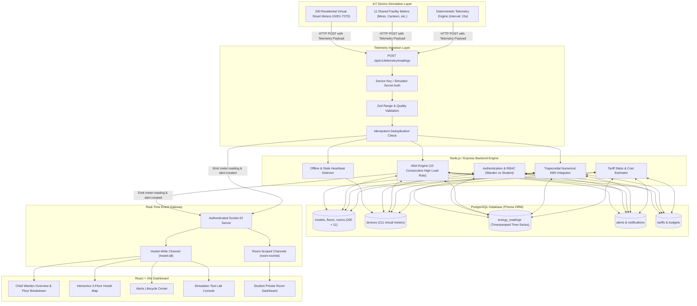

# WattWise System Architecture

## 1. System Overview

**WattWise** is a centralized, real-time IoT-based energy intelligence and hostel monitoring platform designed for high-density student residential facilities.



## 2. Telemetry Ingestion Contract

The telemetry interface accepts both single readings and batches:

```json
{
  "deviceId": "WW-G024",
  "sequenceNumber": 1024,
  "timestamp": "2026-10-19T10:30:00Z",
  "powerW": 280.5,
  "voltageV": 230.0,
  "currentA": 1.36,
  "powerFactor": 0.90,
  "cumulativeEnergyKWh": 14.85,
  "quality": "valid"
}
```

### Ingestion Validation Pipeline:
1. **Source Authentication**: Verifies `x-simulator-key` or device `x-device-key`.
2. **Schema & Range Sanity**: Voltage (100–300V), Power (0–100kW), Current (0–200A), Power Factor (0–1.0).
3. **Sequence & Idempotency**: `(deviceId, sequenceNumber)` uniqueness constraint prevents double-counting.
4. **Energy Discontinuity Detection**: Flags resets or negative energy deltas explicitly.
5. **Persistence**: Saves to PostgreSQL `energy_readings` table.
6. **Alert Evaluation**: Feeds to `AlertService`.
7. **WebSocket Broadcast**: Emits `meter:reading` to authorized Socket.IO rooms.

## 3. High-Consumption Alert Engine (Section 12 Compliance)

- **Default Interval**: 15 seconds.
- **Rule**: If a room's power exceeds its configured threshold (`highPowerThresholdW`, e.g. 800W for residential rooms) for **10 consecutive valid readings** (~150 seconds / 2.5 minutes), a `SUSTAINED_HIGH_POWER` alert triggers.
- **Counter Reset**: Any valid normal reading immediately resets the consecutive count to 0.
- **Deduplication**: Active incidents are updated without creating duplicate spam.
- **Lifecycle**: `TRIGGERED` &rarr; `ACKNOWLEDGED` &rarr; `INVESTIGATING` &rarr; `RESOLVED`.
- **Targeted Notification**: Only the student assigned to that room and authorized wardens receive the alert notification.

## 4. Role-Based Access Control (RBAC) Security Architecture

- **Warden**: Universal access to all 3 floors, 200 rooms, 11 shared facilities, analytics, tariffs, and simulator controls.
- **Student**: Strict room isolation enforced at the backend middleware (`requireRoomAccess`) and Socket.IO level. A student assigned to `G024` cannot query or subscribe to `S210` under any circumstances (returns 403 Forbidden).
